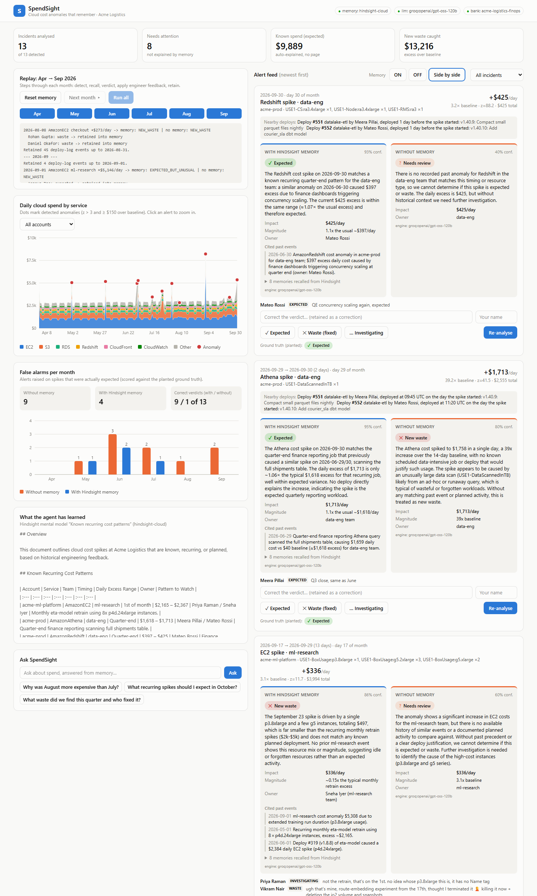
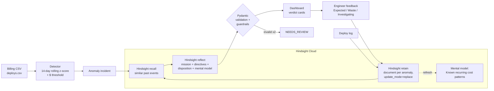
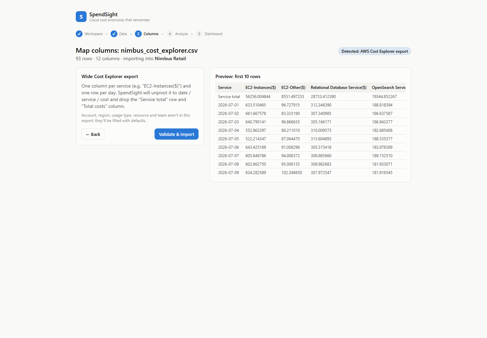
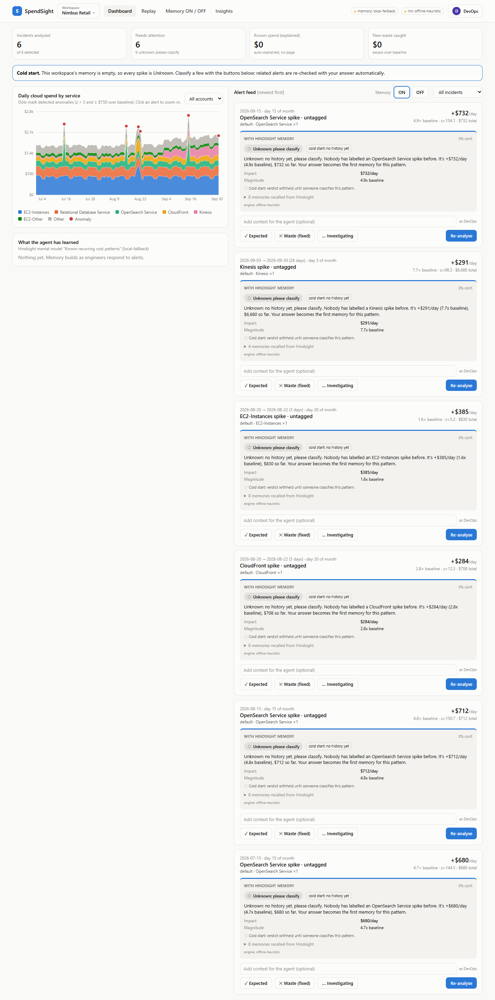
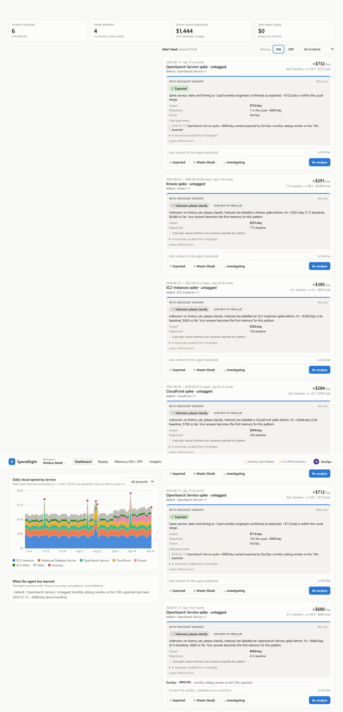

# SpendSight

**A FinOps agent that remembers why your cloud bill spiked, so it stops paging you for the same expected spike every month.**

SpendSight detects cloud cost anomalies with plain statistics, then uses [Hindsight](https://github.com/vectorize-io/hindsight) memory of past anomalies, engineer feedback and deploys to decide whether each spike is **EXPECTED**, **NEW_WASTE**, or **EXPECTED_BUT_UNUSUAL** (a known event with an abnormal size). Every engineer response is retained, so the agent gets better with every alert.



## The problem

Cost tools are good at spotting spikes and bad at remembering what they meant. The ML team's monthly retrain on the 1st, the quarter-end finance job, a planned load test: each one pages someone, who explains it in Slack, and next month the tool pages them again. Meanwhile the real problems (a staging environment left up over a weekend, an egress bug after a deploy, a forgotten GPU box) get lost in the noise.

## How it works



1. **Detect** (`backend/app/detection/detector.py`, no LLM): daily cost per `(account, service, team_tag)`, compared with the mean and standard deviation of the *previous* 14 days. A day is flagged when z > 3 **and** the cost is at least $150 above baseline. Consecutive days merge into one incident, and an incident keeps extending while cost stays above its frozen starting baseline, so slow-burn waste shows up as one 13-day, $4k incident instead of disappearing once the rolling window absorbs it.
2. **Recall**: a natural-language description of the spike (service, team, weekday, day of month, magnitude, line items) is sent to `recall`, with `query_timestamp` set to the incident date so replay never sees the future.
3. **Reflect**: `reflect(..., response_schema=VERDICT_JSON_SCHEMA)` returns a structured verdict, reasoning with the bank's mission, directives, high-skepticism disposition and mental model. If reflect fails, Groq (`openai/gpt-oss-120b`, falling back to `qwen/qwen3-32b`) gets the recalled memories as context.
4. **Validate**: every output is parsed into a Pydantic `Verdict`. Invalid output gets one retry with the validation error fed back, then becomes `NEEDS_REVIEW`. The pipeline never raises.
5. **Guardrails in code**: "Never EXPECTED without a cited past event" is enforced even if the model ignores the directive. The model also reports the usual excess of past occurrences it recalled, and code computes the ratio and picks EXPECTED vs EXPECTED_BUT_UNUSUAL (≥ 1.6×). The model recalls; code does the arithmetic.
6. **Retain**: each engineer response re-retains the anomaly's whole feedback thread under `document_id=anomaly-<id>` with `update_mode="replace"`, so a correction ("not waste, that was our load test") replaces the stale conclusion instead of competing with it. Deploy-log events are retained in batches as replay time passes them.

### How Hindsight is used

| Hindsight feature | Where | What it does for SpendSight |
|---|---|---|
| `create_bank` (mission, `retain_mission`, disposition skepticism=5) | `memory/hindsight_client.py` | FinOps persona; retain extraction focused on dollars, dates, owners and deploys |
| `create_directive` ×4 | same | Cite before EXPECTED; always state dollar impact; flag unusual magnitude; a deploy explains resources, it doesn't excuse them running forever |
| `create_mental_model` "Known recurring cost patterns" | same | Living summary of what the agent has learned, shown in the UI and refreshed after each replay month |
| `retain` / `retain_batch` (tags, metadata, timestamps, `update_mode="replace"`) | `pipeline/service.py` | Feedback threads and deploy log |
| `recall` (`query_timestamp`) | `pipeline/agent.py` | Similar past anomalies, feedback and deploys, shown on each card |
| `reflect` (`response_schema`, `apply_all_directives`) | `pipeline/agent.py` | The structured verdict itself |
| `reflect` (free text) | `/api/chat` | "Why was August more expensive than July?" |

All Hindsight calls go through `backend/app/memory/hindsight_client.py`. It also contains `LocalMemory`, a keyword-overlap stand-in used by the tests and when no `HINDSIGHT_API_KEY` is set, so the app still runs without keys. The header badge always shows which backend is live.

## Product flow: bring your own data

**Login → Workspace → Data input → Column mapping → Processing → Dashboard** (plus Replay, Memory ON/OFF and Insights tabs).

| Step | What happens |
|---|---|
| **Login** | Mock auth (no real authentication). Email and password are prefilled with `devops@acmelogistics.com`, and "Continue with Google" also just signs you in. The signed-in user's name is recorded on every feedback action and included in the memory retained into Hindsight. |
| **Workspace** | *Acme Logistics (demo data)* or *New workspace (upload your own data)*. Each workspace has its own data folder, SQLite database and **its own Hindsight bank** (`spendsight-<id>`), so one company's history never leaks into another's. |
| **Data input** | Load the demo in one click; upload a billing CSV (drag and drop, downloadable template); or "Connect AWS account" (disabled: *Coming soon: AWS Cost Explorer / CUR*). |
| **Column mapping** | The format is auto-detected: **AWS CUR** (legacy and 2.0), **AWS Cost Explorer** (wide console export, unpivoted automatically), **GCP**, **Azure**, **FOCUS**, or generic. Map `date`, `service`, `cost_usd` (required) and `account`, `region`, `usage_type`, `resource_id`, `team_tag` (optional, with defaults; team can come from a Tags column). Shows a 10-row preview. |
| **Validation** | Bad rows are skipped and reported with row numbers and reasons, never fatal. Hourly or per-resource rows are aggregated to daily. The summary shows date range, accounts, services, total spend, and warnings (e.g. < 14 days, credits). You can optionally upload a `deploys.csv` with flexible column names. |
| **Processing** | Step progress: parsing → detecting anomalies → checking memory → generating verdicts. Then it redirects to the dashboard (or to Replay for the demo). |
| **Cold start** | A new workspace starts with empty memory. A spike in a pattern nobody has classified gets **UNKNOWN: "no history yet, please classify"** instead of a guess. The only exception is when a concrete deploy backs the verdict. When you classify one, later alerts of the same pattern are **automatically re-checked** with your answer. |



A second synthetic company is included for testing: `scripts/generate_nimbus.py` writes **Nimbus Retail** (Jul–Sep 2026, AWS Cost Explorer wide format, OpenSearch/Kinesis/CloudFront, deliberately broken cells) plus a deploy log with different column names. Upload `data/samples/nimbus_retail/nimbus_cost_explorer.csv` into a new workspace. Every spike starts as *Unknown*. Classify July's OpenSearch reindex once, and August's and September's reindexes turn **EXPECTED**, citing your note.

| Cold start (empty memory) | After one classification |
|---|---|
|  |  |

New endpoints (all scoped by the `X-Workspace` header):
`GET/POST /api/workspaces`, `POST /api/upload/billing` (inspect + preview), `POST /api/upload/billing/commit` (mapping → validate → import), `POST /api/upload/deploys`, `GET /api/upload/template`, `POST /api/demo/load`, `POST /api/analyze`, `GET /api/analyze/status`, `GET /api/insights`.

## The dataset

`scripts/generate_data.py` generates 6 months (Apr–Sep 2026) of CUR-style billing for the fictional Acme Logistics: 3 AWS accounts, real on-demand instance prices, one row per instance, weekday/weekend patterns, AR(1) noise and slow growth (23,656 rows, about $83k–$100k per month). Seven stories are planted:

| # | Event | Truth |
|---|---|---|
| 1 | eta-model retrain on 8× p4d.24xlarge on the 1st of every month | EXPECTED |
| 2 | Quarter-end finance job: Athena scans + Redshift concurrency scaling (29–30 Jun, 29–30 Sep) | EXPECTED |
| 3 | k6 load test for the Monsoon Mega Sale, 60× c6i.4xlarge (14 Jul), announced in deploy #399 | EXPECTED |
| 4 | cart-v3 perf environment left running in staging over the 8–9 Aug weekend | NEW_WASTE |
| 5 | image-service deploy #421 serves thumbnails straight from S3, bypassing CloudFront: S3 egress ~15× while CloudFront bytes drop | NEW_WASTE |
| 6 | September retrain costs 2.3× the usual amount after deploy #487 added 18 months of GPS history | EXPECTED_BUT_UNUSUAL |
| 7 | A forgotten p3.8xlarge in the *same* ml-research EC2 group as the retrain, but on the 17th | NEW_WASTE |

It also writes `deploys.csv` (354 deploys), `seed_feedback.json` (18 Slack-style notes, including conflicting feedback that gets corrected) and `planted_events.json` (ground truth used only for scoring). The detector finds exactly these 13 incidents and nothing else; `tests/test_detection.py` checks this.

## Setup

Requirements: Python 3.11+, Node 20+.

```bash
cp .env.example .env          # add GROQ_API_KEY and HINDSIGHT_API_KEY
./run.sh                      # macOS/Linux   (Windows: .\run.ps1)
```

Or manually:

```bash
python -m venv .venv && .venv/bin/pip install -r backend/requirements.txt
.venv/bin/python scripts/generate_data.py
.venv/bin/python -m uvicorn app.main:app --port 8000 --app-dir backend
cd frontend && npm install && npm run dev      # http://localhost:5173
```

Or `docker compose up`.

| Env var | Default |
|---|---|
| `GROQ_API_KEY` | none. Without it, verdicts use a deterministic offline heuristic |
| `GROQ_MODEL` / `GROQ_FALLBACK_MODEL` | `openai/gpt-oss-120b` / `qwen/qwen3-32b` |
| `HINDSIGHT_API_KEY` | none. Without it, `LocalMemory` is used |
| `HINDSIGHT_BASE_URL` | `https://api.hindsight.vectorize.io` |
| `HINDSIGHT_BANK_ID` | `acme-logistics-finops` |

Tests: `cd backend && ../.venv/bin/python -m pytest` (39 tests: detection, format detection / normalization, verdict parsing/retry/fallback, guardrails, cold start, calendar, full offline replay, and the upload → analyze → feedback → learning API flow).

## Demo walkthrough

1. **Reset memory**: deletes and recreates the Hindsight bank (mission, directives, mental model). The agent knows nothing.
2. **Next month ▸ (May)**: the retrain spike arrives. With no history the agent says so ("cold start") and raises `NEEDS_REVIEW`. Daniel from FinOps asks "is this you?", and Priya replies it's the monthly retrain. Both are retained.
3. **June**: the retrain is now `EXPECTED`, citing May's feedback. The quarter-end Athena/Redshift spikes are new, so they're alerts. Meera explains them.
4. **July**: the retrain is quiet. The load test is a first sighting, so it's flagged and its owner corrects it. The S3 egress spike is `NEW_WASTE`, tied to image-service deploy #421 (the day CloudFront bytes dropped).
5. **Toggle Memory OFF / Side by side**: the same anomalies with no history. The no-memory agent can't cite anything, so every expected spike becomes a page.
6. **September**: the retrain is `EXPECTED_BUT_UNUSUAL` (2.3× usual, citing deploy #487); quarter-end is `EXPECTED` (remembered from June). The forgotten p3.8xlarge is `NEW_WASTE`: it's the same team and service as the retrain, but it doesn't match the pattern.
7. **False alarms per month**: the learning curve. On a full replay with Hindsight Cloud + Groq: correct verdicts go from 1/13 to 9/13, false alarms from 9 to 4 (all first sightings, 0 in September), and no waste is missed. The replay takes about 6 minutes. LLM output varies a little from run to run.
8. **Give feedback / correct it** on any card, then **Re-analyse**. Corrections replace the old memory document.
9. **Ask SpendSight**: "Why was August more expensive than July?" is answered by `reflect` over memories and billing context.

### Screenshots

- `docs/dashboard.png`: full dashboard after a replay
- _placeholder: side-by-side memory ON/OFF card_
- _placeholder: learning curve after replay with Hindsight Cloud + Groq_

## Project layout

```
backend/app/
  api/routes.py            FastAPI endpoints (/api/...)
  detection/detector.py    rolling z-score detector + incident merging
  memory/hindsight_client.py   the ONLY Hindsight module (+ LocalMemory stand-in)
  llm/groq_client.py       Groq primary/fallback models
  llm/verdict.py           JSON extraction, Pydantic validation, guardrails
  models/schemas.py        Anomaly, Verdict, VerdictRecord, JSON schema for reflect
  db/store.py              SQLite: billing, anomalies, verdicts, feedback, replay state
  pipeline/agent.py        recall -> reflect -> validate -> guardrails; memory OFF baseline
  pipeline/narrative.py    text we retain and query with
  pipeline/service.py      per-workspace: ingest, analysis job, feedback -> retain, replay, learning curve, chat
  ingest/normalize.py      format detection (CUR, Cost Explorer, GCP, Azure, FOCUS), mapping, validation
  workspaces.py            workspace registry: one data dir + SQLite + Hindsight bank each
frontend/src/              React + Vite + Tailwind + Recharts dashboard
scripts/generate_data.py   synthetic Acme Logistics data (demo)
scripts/generate_nimbus.py second company, AWS Cost Explorer format (upload test)
```

## Edge cases handled

- **Cold start**: memory mode reports "no similar past event" instead of guessing.
- **Conflicting feedback**: the load test is called waste, then corrected by its owner. The retained document holds the whole thread and the final resolution.
- **Corrections**: any card can be re-labelled. The new thread replaces the old memory (`update_mode="replace"`).
- **Invalid LLM output / API errors**: one retry, then `NEEDS_REVIEW`. Hindsight outages degrade to `NEEDS_REVIEW` too.
- **Empty or short data**: no anomalies until a full 14-day baseline exists. Empty CSVs return an empty feed.
